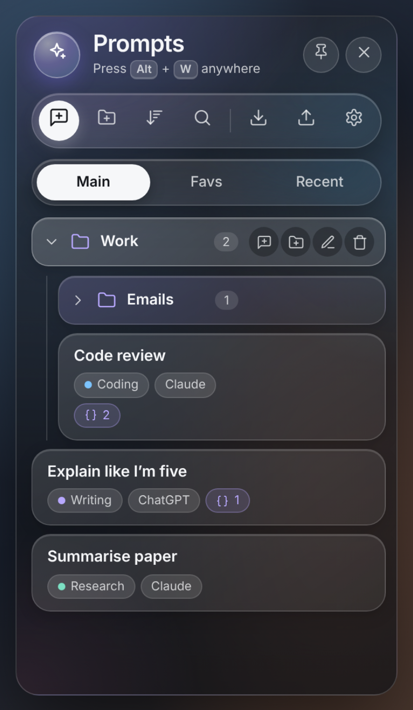

<div align="center">

# Prompt Paster

**Your prompt library, one hotkey away.**
Press <kbd>Alt</kbd> + <kbd>W</kbd> in any app, pick a saved prompt, and it is pasted straight into the field you were typing in.


</div>

<!-- TODO: replace with a real screenshot of the app (suggested size: ~720×1280, PNG). Save it as docs/screenshot.png -->
<p align="center">
  
</p>

---

## Why Prompt Paster?

If you use AI chats, coding assistants, or any tool where you keep retyping the same instructions, you know the routine: dig through notes, copy, switch window, paste. Prompt Paster removes all of that. It sits quietly in the background, and a single shortcut opens a frosted-glass list of your prompts right where you are working. Click one and it lands in the input field you were using, then the window gets out of your way.

## Features

- **Global hotkey** – <kbd>Alt</kbd> + <kbd>W</kbd> by default (changeable in Settings) opens the list over any app.
- **One-click paste** – pick a prompt and it is pasted into the previously focused field; the window closes automatically.
- **`{variables}`** – write `tell me about {random topic}` and a small box appears at your cursor to fill the blanks in. <kbd>Tab</kbd> moves to the next field, <kbd>Enter</kbd> pastes. Empty variables stay as `{name}`.
- **Folders** – nest them as deep as you like, or don't use them at all. Rename anytime.
- **Categories and platforms** – tag each prompt with a category and an optional platform (for example "Claude" or "ChatGPT").
- **Platform filter** *(optional, Windows)* – when the list opens over an app whose window title or process name matches a prompt's platform, only matching prompts are shown, with a one-click "Show all" override.
- **Main / Favs / Recent tabs** – the full list, your most used prompts, and what you used lately.
- **Flexible sorting** – by name, creation date, modified date, size, last used, or most used. **Category mode** filters by checked categories; **Free mode** lets you drag and drop items into your own order, which is remembered.
- **Animated search** – filters by title, with a "Body" toggle to search the prompt text too.
- **Import / Export** – back up everything as a `.json` file. Import can merge with or replace your current data.
- **Glassmorphism UI** – frameless, resizable window with the blurred desktop visible behind it, tuned for readable text.
- **Keyboard friendly** – <kbd>↑</kbd>/<kbd>↓</kbd> to navigate, <kbd>Enter</kbd> to paste, <kbd>Esc</kbd> to close, and just start typing to search.
- **Safe by default** – every destructive action asks for confirmation.
- **Lives in the tray** – single instance, optional launch at login, optional hide on blur, and a pin button to keep the list open.

## Install

### Prerequisites

- [Node.js](https://nodejs.org/) 20 or newer
- [Rust](https://www.rust-lang.org/tools/install) (stable)
- The [Tauri 2 system dependencies](https://v2.tauri.app/start/prerequisites/) for your OS (on Windows 11: Microsoft C++ Build Tools and WebView2, which is already included in Windows 11)

### Run and build

```bash
# 1. Install dependencies
npm install

# 2. Run the desktop app in development mode
npm run dev

# 3. Build installers for your platform
npm run build
# → output in src-tauri/target/release/bundle/
```

## Usage

1. Put the cursor in any text field (a chat box, an editor, a browser form).
2. Press <kbd>Alt</kbd> + <kbd>W</kbd>. The Prompt Paster window opens.
3. Click a prompt, or use the arrow keys and <kbd>Enter</kbd>. It is pasted into the field.

### Header buttons

| Button | What it does |
|---|---|
| **Add prompt** | Create a prompt: title, body, optional category, platform and folder |
| **Folder** | Add a folder (nesting supported) |
| **Sort** | Sorting, Category mode (filter and manage categories) and Free mode (drag and drop order) |
| **Search** | Animated search by title, optionally by body |
| **Import / Export** | Load or save all your data as JSON. The first export asks for a location, and later clicks rewrite the same file. Hold the button for 400 ms to pick a new location |
| **Settings** | Shortcut, display and behavior options |

Hovering over a prompt reveals **edit**, **duplicate** and **delete** actions.

### Variables

Wrap a name in curly braces anywhere in a prompt body:

```text
Explain {topic} to me like I'm {age} years old.
```

When you pick this prompt, a small box appears near the field you were typing in with one input per variable.

- <kbd>Tab</kbd> moves to the next field and <kbd>Enter</kbd> pastes.
- Variables left empty are pasted unchanged, as `{topic}`.
- To paste literal braces, escape them: `\{not a variable}` pastes as `{not a variable}`.

### Settings

Settings include:

- Change the global shortcut
- Expand all prompts (show up to 3 lines of each body)
- Hide on blur
- Launch at login
- Desktop blur and glass strength
- Restore the previous clipboard after pasting
- Auto-update the export file whenever your data changes
- Platform filter (and whether to also show prompts without a platform)
- Clear usage history

## Your data

Everything is stored locally. Nothing is sent anywhere. Your library lives in `data.json` in the OS app-data folder (the exact path is shown in Settings → Data). Device-specific settings, such as the shortcut and export path, are kept separately and are not included in exports. To reset the app, delete `data.json`.

## Platform notes

- **Windows** – primary target and the most complete: foreground-app detection for the platform filter and focus restore when the window is pinned. If dragging or resizing the window is laggy, turn off *Desktop blur* in Settings.
- **macOS** – grant the app *Accessibility* permission (System Settings → Privacy & Security), otherwise nothing can be pasted.
- **Linux** – works on X11. Wayland generally blocks global shortcuts and synthetic input, and there is no desktop blur.
- Pasting works by simulating <kbd>Ctrl</kbd>/<kbd>Cmd</kbd> + <kbd>V</kbd>, so terminals that require <kbd>Ctrl</kbd> + <kbd>Shift</kbd> + <kbd>V</kbd> won't accept it.
- If the shortcut is already taken by another app, a notification tells you. Pick a different one in Settings.

## Development

```bash
npm test          # pure-logic tests, no Rust needed
npm run serve     # UI only, in a browser with a mock backend → http://localhost:1420
cd src-tauri && cargo check   # type-check the Rust backend
```

The frontend is plain ES modules with no build step. The backend is a small Tauri 2 (Rust) app. For the project layout, data model and design decisions, see:

- [`docs/DEVELOPMENT.md`](docs/DEVELOPMENT.md) – setup, commands and troubleshooting
- [`docs/ARCHITECTURE.md`](docs/ARCHITECTURE.md) – structure, data model and flows
- [`docs/SPEC.md`](docs/SPEC.md) – the product spec and decisions
- [`docs/DESIGN.md`](docs/DESIGN.md) – visual design notes
- [`docs/ROADMAP.md`](docs/ROADMAP.md) – known limitations and ideas
- [`CHANGELOG.md`](CHANGELOG.md) – release history

Working on this project with an AI agent? Start with [`AGENTS.md`](AGENTS.md).

## Tech stack

[Tauri 2](https://v2.tauri.app/) · Rust (`arboard` for clipboard, `enigo` for simulated paste) · vanilla JavaScript, HTML and CSS